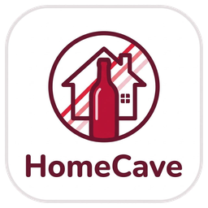

<p align="center">
  
</p>

<h1 align="center">HomeCave</h1>

<p align="center">
  <strong>HomeCave - your local Wine Cellar · Home Assistant Wine Inventory, AI Bottle Label Scanner, SommAI Pairing &amp; Vivino Cellar Manager</strong>
</p>

<p align="center">
  <a href="https://my.home-assistant.io/redirect/hacs_repository/?owner=Maartenwiese&amp;repository=HomeCave&amp;category=integration">
    
  </a>
</p>

<p align="center">
  <a href="https://github.com/Maartenwiese/HomeCave/actions/workflows/validate.yml">
    
  </a>
  <a href="https://github.com/Maartenwiese/HomeCave/releases/latest">
    
  </a>
  <a href="LICENSE">
    
  </a>
</p>

---

**HomeCave** (`homecave`, version `0.9.5`) is a native Home Assistant custom integration, bundled Lovelace frontend card suite (`custom:homecave-card`, `custom:homecave-summary-card`, `custom:homecave-sommai-card`), and standalone Mobile Progressive Web App (`/homecave`) that keeps track of your local wine cellar. It stores your inventory in a local SQLite database (`<config>/homecave/homecave.db`), scans wine bottle photos using **AI vision models** (supporting both **Google Gemini** and **Anthropic Claude**), pairs dishes with your active cellar via **SommAI**, enriches bottles with **Vivino community ratings** and **AI sommelier research**, and tracks every addition with date/time added, where it was bought, physical storage location, drinking window (*Ready*, *Soon*, *Keep*, *Past Peak*), and tasting notes.

Built following the [**`homeassistant-ai/skills`**](https://github.com/homeassistant-ai/skills) (`home-assistant-best-practices`) standards and 100% HACS &amp; Hassfest compliant.

---

## ✨ Key Features

- **🍷 Local SQLite Cellar Database (`homecave.db`)**:
  - Relational schema with master `wines`, child `inventory_additions` batches (recording `added_at` date/time, `purchase_location`, `purchase_price`, physical `storage_location`, `drink_window_note`, and batch `notes`), and `consumption_history` (personal ratings, tasting notes &amp; audit log).
  - Automatic Write-Ahead Log (`WAL`) checkpointing hooked into Home Assistant Core Backups (`backup.py`).
- **📸 Visual Bottle Label Scanning with AI Models &amp; Interactive Crop/Rotate**:
  - Supports **multi-provider AI models** configured directly in Home Assistant Integration Settings: choose between **Google Gemini** (default `gemini-3.5-flash-lite`) or **Anthropic Claude** (default `claude-haiku-5-5`).
  - Built-in **vision guardrail** verifies that every scanned photo contains a real wine bottle or wine label before cataloguing.
  - **Interactive Crop &amp; Rotate Modal**: Rotate photos ±90° or fine-straighten (−20°…+20°) and drag handles to frame only the wine label for optimal vision recognition.
  - Extracts Winery, Wine Name, Vintage (`YYYY` or `NV`), Wine Style (`red`, `white`, `rose`, `sparkling`, `dessert`, `fortified`), Varietal, Region, Country, Alcohol %, recommended Drinking Window (`drink_from_year`–`drink_until_year`), Food Pairings, and a concise label summary.
  - Automatically detects duplicates already in your HomeCave cellar so you can increment bottle stock in one tap.
- **🤖 SommAI Food &amp; Wine Pairing Assistant &amp; Deep Producer Research**:
  - **SommAI** (`custom:homecave-sommai-card` and the Mobile App `🤖 SommAI` tab) pairs recipes, ingredients, or uploaded dish photos exclusively against bottles currently in stock in your HomeCave cellar (`quantity > 0`).
  - **AI Deep Wine Research**: One-tap `✨ Research Wine` in Detailed View generates producer heritage, vineyard terroir, tasting profile narrative, 0–100 structural taste sliders (*Soft–Acidic*, *Light–Bold*, *Dry–Sweet*), and culinary pairings using your configured AI model.
- **⭐ Grounded Vivino Lookup &amp; Full Vivino ZIP/CSV Import**:
  - Searches Vivino using only text verifiably printed on the label, pre-filters exact producer &amp; cuvée candidates, and uses an AI judge to confirm verified matches without ever inventing ratings.
  - Supports full **Vivino Export `.zip` &amp; `.csv` imports** (`full_wine_list.csv` + `cellar.csv`), preserving Vivino links, downloading bottle cover photos with automatic backoff retries, marking imported bottles (`📥 Imported`), and optionally enriching missing varietals and drinking windows with AI models while reporting live background progress.
- **🏠 Home Assistant-Native Lovelace Cards &amp; Multi-View Sections Dashboard**:
  - Automatically registers `/homecave_frontend/homecave-card.js`.
  - Ships with three cards in the Home Assistant UI Card Picker:
    1. **HomeCave Wine Cellar Card** (`custom:homecave-card`) — full cellar manager, AI label scanner, all-details search, invertible sort, and tasted archive.
    2. **HomeCave Cellar Quick Card** (`custom:homecave-summary-card`) — compact summary widget for any Home Assistant overview page.
    3. **HomeCave SommAI Card** (`custom:homecave-sommai-card`) — interactive AI Sommelier food-pairing card.
  - Ships with a complete Home Assistant **`sections` dashboard** ([`dashboards/homecave-dashboard.yaml`](dashboards/homecave-dashboard.yaml)) featuring `Cellar Overview`, `Tasted`, `SommAI`, and `Statistics` views bound to `sensor.homecave_*`.
- **📱 Standalone Installable Mobile Web App (`/homecave`)**:
  - Runs a mobile-first Progressive Web App (PWA) at **`http://<your-home-assistant>:8123/homecave`** in parallel to the native Home Assistant UI, launching with the **HomeCave** startup splash (*"HomeCave - your local Wine Cellar"*).
  - **Inherits Home Assistant Authentication**: Reuses your Home Assistant login session (`hassTokens` / OAuth2 refresh) and enforces `requires_auth = True` on all `/api/homecave/pwa/*` endpoints.
  - **Installable to Home Screen (`standalone`)** on iOS and Android with its dedicated HomeCave emblem icon, Large (`L`) default typography, touch-first sheets, camera/library photo upload in Detailed View, and Service Worker shell caching.

---

## 📖 User Manual

### 1. Installing HomeCave via HACS

#### Method A: HACS Store / One-Click Install (Recommended)

[](https://my.home-assistant.io/redirect/hacs_repository/?owner=Maartenwiese&repository=HomeCave&category=integration)

1. Click the **Open HACS Repository** button above (or open **HACS** in your Home Assistant sidebar and search for **HomeCave**).
2. Open **HomeCave** and click **Download** in the bottom-right corner (`v0.9.5` or newer).
3. **Restart Home Assistant** (**Settings → System → Restart**) so Home Assistant loads the `homecave` integration.

#### Method B: Custom Repository (Before HACS Default Store Inclusion)

1. Open your Home Assistant UI and click **HACS** in the left sidebar.
2. Click the **three dots (`⋮`)** in the top-right corner of HACS and select **Custom repositories**.
3. Fill in the dialog:
   - **Repository**: `https://github.com/Maartenwiese/HomeCave`
   - **Type / Category**: Select **Integration**
4. Click **Add**, then close the dialog.
5. Search for **HomeCave** in HACS, open it, and click **Download** in the bottom-right corner. Confirm the download (`v0.9.5` or newer).
6. **Restart Home Assistant** (**Settings → System → Restart**) so Home Assistant loads the `homecave` integration.

---

### 2. Enabling &amp; Configuring the HomeCave Integration

Once Home Assistant has restarted:

1. Go to **Settings → Devices &amp; Services** and click **+ Add Integration**.
2. Search for **HomeCave** and select it.
3. Fill in the configuration dialog:
   - **Cellar Name**: Defaults to `HomeCave` (determines the name of your device and summary sensors, e.g., `sensor.homecave_total_bottles`, `sensor.homecave_ready_to_drink`, `sensor.homecave_keep_bottles`, `sensor.homecave_past_peak_bottles`).
   - **AI / LLM Provider**: Choose **Google Gemini** or **Anthropic Claude** from the dropdown.
   - **API Key &amp; Model ID**:
     - For **Google Gemini**: Paste your Google Gemini API key (from [Google AI Studio](https://aistudio.google.com/apikey)) and confirm the model ID (default `gemini-3.5-flash-lite`).
     - For **Anthropic Claude**: Paste your Anthropic Claude API key (from [Anthropic Console](https://console.anthropic.com/)) and confirm the model ID (default `claude-haiku-5-5`).
   - **Currency Code**: e.g., `EUR` or `USD`.
   - **Vivino Country Code**: e.g., `NL`, `US`, `FR`, `DE`, `IT`.
   - **Low Stock Alert Threshold**: Number of remaining bottles (default `2`) that triggers a `stock_low` event when a bottle is consumed.
   - **Optional HomeCave / Fridge Temperature &amp; Humidity Sensors**: Enter existing Home Assistant sensor entity IDs (e.g., `sensor.wine_fridge_temperature` and `sensor.wine_fridge_humidity`) to display live storage conditions inside the HomeCave header bar.
4. Click **Submit**.
   - HomeCave automatically initializes `<config>/homecave/homecave.db`, creates summary sensors + an `event.homecave_activity` entity, and registers the **HomeCave** Lovelace cards.

---

### 3. Creating Your HomeCave Dashboard

#### Option A: Create a Dedicated Full HomeCave Dashboard (Recommended)
1. Go to **Settings → Dashboards** and click **+ Add Dashboard**.
2. Choose **New dashboard from scratch**:
   - **Title**: `HomeCave`
   - **Icon**: `mdi:glass-wine`
   - **URL path**: `homecave-cellar` (must contain a hyphen)
   - Click **Create**.
3. Open your new **HomeCave** dashboard from the left sidebar.
4. Click **Edit Dashboard (pencil icon)** → **three dots (`⋮`)** → **Raw configuration editor**.
5. Paste the contents of [`dashboards/homecave-dashboard.yaml`](https://github.com/Maartenwiese/HomeCave/blob/main/dashboards/homecave-dashboard.yaml) *(hosted in this GitHub repository, since HACS extracts only `custom_components/homecave/` onto your Home Assistant host)* and click **Save**.

#### Option B: Add a HomeCave Card to Any Existing Home Assistant Page
1. Open any dashboard view, click **Edit (pencil)** → **+ Add Card**, and search for **HomeCave**:
   - **HomeCave Cellar Quick Card** (`custom:homecave-summary-card`):
     ```yaml
     type: custom:homecave-summary-card
     title: HomeCave
     show_recent: true
     show_style_bar: true
     dashboard_path: /homecave-cellar/overview
     ```
   - **HomeCave Wine Cellar Card** (`custom:homecave-card`):
     ```yaml
     type: custom:homecave-card
     title: HomeCave
     default_view: list
     font_scale: 1
     ```
   - **HomeCave SommAI Card** (`custom:homecave-sommai-card`):
     ```yaml
     type: custom:homecave-sommai-card
     title: HomeCave SommAI
     ```

#### Option C: Launch &amp; Install the Standalone Mobile Web App (`/homecave`)
1. Open **`http://<your-home-assistant>:8123/homecave`** in Chrome (Android) or Safari (iOS), or tap the **📱 Mobile App** button in any HomeCave card header.
2. On launch, the **HomeCave** startup screen displays the HomeCave logo and *"HomeCave - your local Wine Cellar"*.
3. Tap **📲 Install** in the **⚙️ Config** tab (or Safari **Share → Add to Home Screen**) to install **HomeCave** with its own home-screen icon.

---

### 4. Adding, Scanning &amp; Managing Bottles

1. **Scan a Bottle Photo (AI Model + Vivino)**:
   - Tap **Scan Bottle** (`📷`) in the HomeCave card or the floating **SCAN** button in `/homecave`.
   - Take a camera photo or select one from your library, adjust the interactive **Crop &amp; Rotate** frame around the wine label, and tap **Confirm &amp; Scan Label**.
   - Your configured **AI model** extracts the wine metadata and drinking window while querying **Vivino** for verified community ratings.
   - Choose your physical storage location (e.g., `HomeCave`, `HomeCave Fridge`, `HomeCave - Rack A3`), purchase store, price, and notes, or toggle **🥂 Add to Tasted** to log a wine directly to your tasting archive without incrementing cellar stock.
2. **Filter, Search &amp; Sort**:
   - Filter by drinking window readiness (**Ready**, **Soon**, **Keep**, **Past Peak**) or wine style, invert any sort column (`⇅`), and search across every field, batch location, tasting note, and AI research summary.
3. **Backups, Restores &amp; Exports**:
   - Manage full `.zip` backups (`homecave_backup_<timestamp>.zip`), Vivino `.zip`/`.csv` imports, and CSV/JSON exports from **Settings → Devices &amp; Services → HomeCave → Configure** or via `homecave.create_backup`, `homecave.restore_backup`, `homecave.import_wines`, and `homecave.export_inventory`.

---

### 5. Optional Automation Blueprint (`cellar_alerts.yaml`)

Because HACS installs only `custom_components/homecave/` onto your Home Assistant system, you can import the companion [`blueprints/automation/homecave/cellar_alerts.yaml`](https://github.com/Maartenwiese/HomeCave/blob/main/blueprints/automation/homecave/cellar_alerts.yaml) blueprint (low-stock alerts on `event.homecave_activity` &amp; weekly drinking-window digests) in one click:

[](https://my.home-assistant.io/redirect/blueprint_import/?blueprint_url=https%3A%2F%2Fgithub.com%2FMaartenwiese%2FHomeCave%2Fblob%2Fmain%2Fblueprints%2Fautomation%2Fhomecave%2Fcellar_alerts.yaml)

---

## 🔒 Security

HomeCave follows the OWASP Top 10 and Home Assistant's permission model: backup, restore, import, export, and wine deletion are **admin-only**, backups and bottle photos are never published under `/local/` (photos are served only to logged-in users via short-lived signed URLs), and imported cover images are fetched only from Vivino's image CDN after signature validation. See [SECURITY.md](SECURITY.md) for the full security model and how to report a vulnerability privately.
